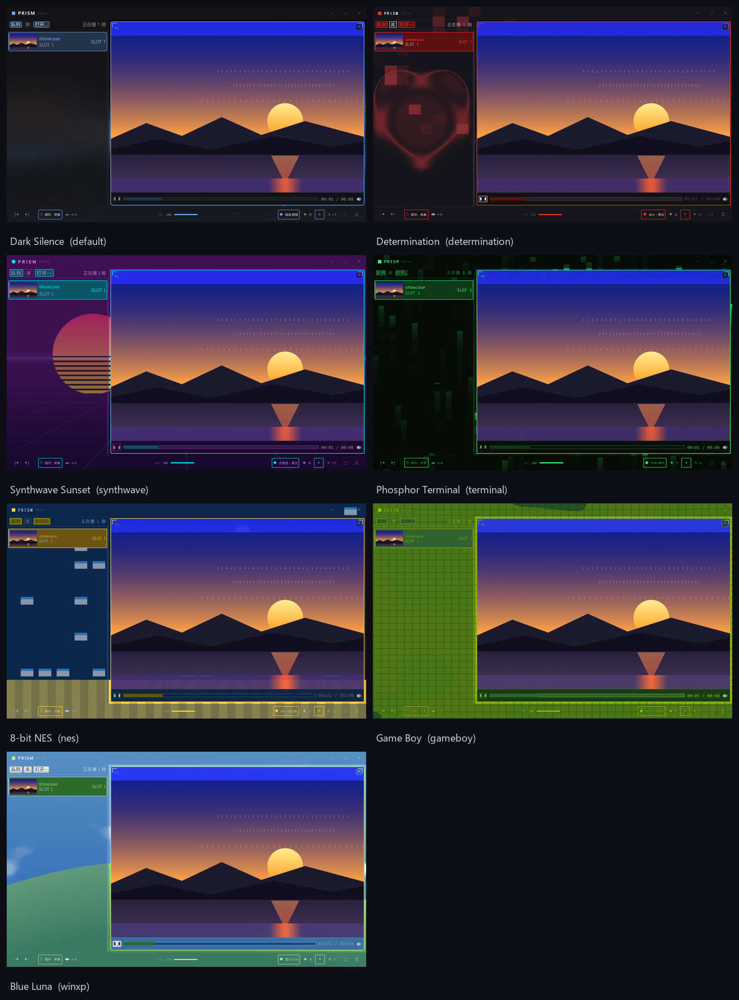
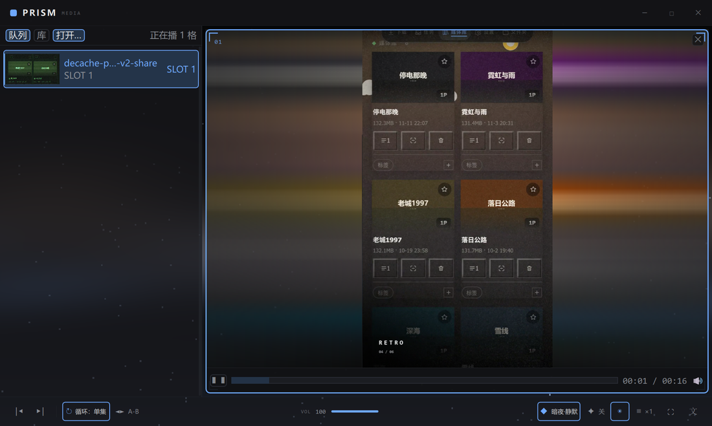

# Prism


**A multi-grid video player for Windows — seven animated themes, Ambilight glow, and per-theme sound design.**

> One prism splits light into many beams. Prism splits one window into up to four synced video grids — each with its own controls, its own theme, and only the focused one makes sound.





---

## Why Prism

Most video players show one file at a time. Prism is built for comparing clips, monitoring multiple feeds, or just having a playlist that lives beside the video you're watching.

- **Multi-grid, on demand** — start with one cell, press `G` to grow to four. Double-click a playlist item to drop it into the next cell. Each cell has its own transport bar; only the focused cell outputs audio.
- **Seven real themes, not color swaps** — each theme changes font, geometry, materials, control shapes, a GLSL animated backdrop, and a full set of interface sounds. Switching is instant, no restart.
- **Ambilight** — the colors at the video edge bleed softly into the empty space around it, pulsing gently. Toggle with `A`.
- **One self-contained folder** — `build/bin/` runs by double-clicking `prism.exe`. Qt runtime, mpv, themes, shaders, and fonts are already beside it. Copy the folder, it still runs.

## Quick start

```bash
# Already built? Just run it.
build/bin/prism.exe
build/bin/prism.exe "path/to/video.mp4"     # opens the whole folder as a playlist

# Rebuild from source (toolchain is bundled, MinGW — not MSVC):
bash build.sh
```

No install, no dev/dist split. Drag a file or folder onto the window and it builds a playlist with natural sorting (`ep2` before `ep10`).

## Controls

| Key | Action |
|---|---|
| `Space` | Play / pause |
| `←` `→` | Seek ±5s (`Shift` ±30s) |
| `↑` `↓` / wheel | Volume |
| `M` | Mute |
| `G` / `D` | Add / remove a grid cell |
| `1`–`4` | Focus a cell |
| `F` / double-click cell | Solo a cell (panel hides, best quality) |
| `F11` | Fullscreen |
| `L` / `B` | Loop mode / A-B loop |
| `T` / `S` | Cycle theme / video shader |
| `A` | Toggle Ambilight |
| `O` / `Ctrl+O` | Open file |

Click a cell to focus it; the transport bar at its bottom takes over. Double-click a playlist item to add a new cell instead of replacing the current one.

## Themes

Each theme is a directory under `themes/` with a `theme.json` and five WAV files. Drop in a new directory and it appears in the theme list — no code changes.

| Theme | Visual signature | Typeface |
|---|---|---|
| Dark Silence (`default`) | Aurora curtains and stars, blue accent, calm | Microsoft YaHei UI |
| Determination (`determination`) | Black field, red pixel heart, particle convergence | SimHei |
| Synthwave (`synthwave`) | Striped sunset, neon perspective grid, glow | Noto Sans SC |
| Phosphor Terminal (`terminal`) | Falling glyphs, scanlines, vignette | Consolas |
| 8-bit NES (`nes`) | Pixel clouds, hard edges, zero gradients | SimSun |
| Game Boy (`gameboy`) | Four-tone green LCD, dot matrix, scanlines | FangSong |
| Blue Luna (`winxp`) | Asymmetric green hills, soft clouds | DengXian |

All seven use distinct CC0 interface samples (Kenney Interface Sounds) with per-theme pitch, filtering, and bit-crushing — the theme-switch chime is a different sound for each one, not the same note transposed.

Video shaders (CRT / VHS / Neon / LCD / Pixel) are independent of themes — switching theme never changes your shader. Press `S` to pick one yourself.

## How it works

| Layer | Role |
|---|---|
| `src/core/` | Theme tokens, playlist, library, view stack, app controller — no UI or engine dependency |
| `src/engine/` | libmpv rendered into a `QQuickFramebufferObject`; playback state is polled back, never duplicated in QML |
| `src/qml/` | Qt Quick UI. Colors and fonts come only from the `Theme` singleton |
| `shaders/` | `bg_dynamic.frag` (seven animated backdrops in one shader), `ambient_glow.frag` (Ambilight), plus mpv video shaders |
| `themes/` | Seven theme directories, auto-discovered at startup |
| `tools/` | Build, verification, and screenshot scripts |

`QSG_RHI_BACKEND=opengl` is forced because libmpv's render API only supports OpenGL. All source-file paths in CMake are absolute — the bundled toolchain must stay in place.

## Docs

- `docs/adr/` — architecture decision records
- `docs/VOLTA-*.md` — design history (i18n, theme tokens, render paths, playlist model)

## License

Prism is [MIT licensed](LICENSE). Bundled third-party components (Qt 6, mpv, Kenney CC0 sounds) carry their own licenses and obligations — documented in [THIRD_PARTY_NOTICES.md](THIRD_PARTY_NOTICES.md). If you plan to redistribute the ready-to-run bundle, read that file first: the exact license mode of the bundled mpv binary has not been confirmed.

---

[中文说明](README_CN.md)
