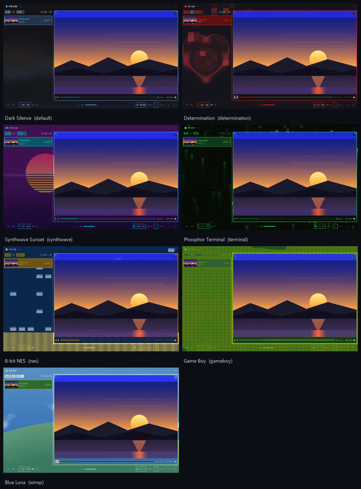
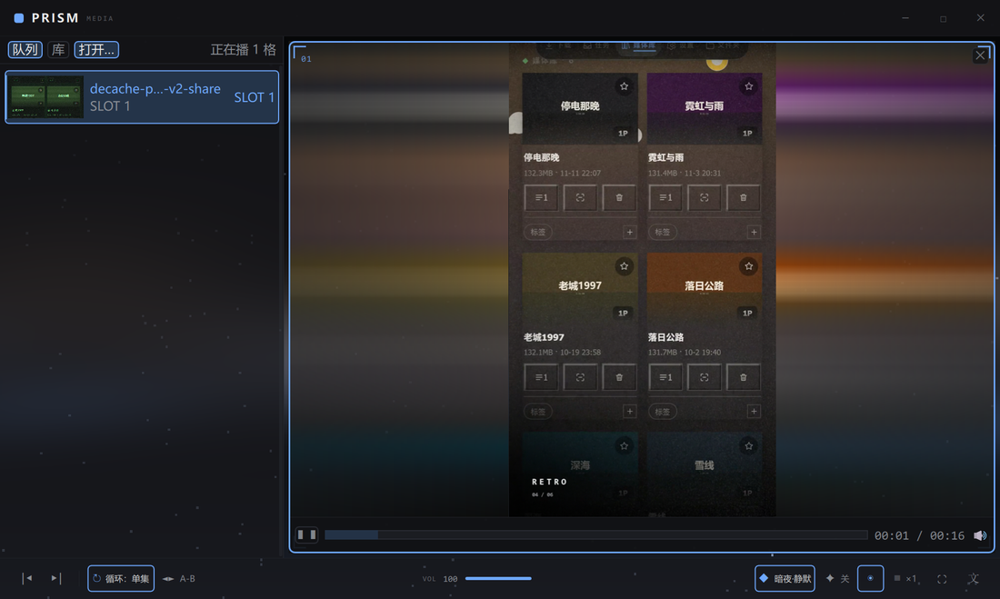

# Prism

**Windows 多格视频播放器 —— 七个动态主题、Ambilight 环境光、每主题独立音效。**

> 一束光经棱镜分成多道。Prism 把一个窗口分成最多四格画面 —— 每格有自己的控制条和主题，但只有焦点格出声。

[English README](README.md)





---

## 为什么做这个

多数播放器一次只放一个文件。Prism 面向需要对比片段、同时看好几路画面、或者想让播放列表就待在视频旁边的人。

- **按需长出网格** —— 默认一格，`G` 加到四格。双击列表项直接开下一格。每格有自己的播放条，只有焦点格出声。
- **七个真主题，不是换色** —— 字体、几何、材质、控件形态、GLSL 动态背景、成套交互音效全换。切换立即生效，不用重启。
- **环境光** —— 视频边缘的颜色柔和地溢到周围空白区，带极轻呼吸。按 `A` 开关。
- **一个自包含目录** —— `build/bin/` 双击 `prism.exe` 就跑，Qt 运行时、mpv、主题、着色器、字体都在旁边，整个目录拷走照样能跑。

## 快速开始

```bash
# 已构建好？直接跑
build/bin/prism.exe
build/bin/prism.exe "视频路径.mp4"     # 自动把整个目录收成播放列表

# 从源码重建（工具链已内置，MinGW 不是 MSVC）：
bash build.sh
```

免安装，无 dev/dist 双轨。拖文件或文件夹进窗口即建列表，自然排序（`ep2` 在 `ep10` 前）。

## 快捷键

| 键 | 作用 |
|---|---|
| `空格` | 播放 / 暂停 |
| `←` `→` | ±5 秒（`Shift` ±30 秒）|
| `↑` `↓` / 滚轮 | 音量 |
| `M` | 静音 |
| `G` / `D` | 增加 / 收起一格 |
| `1`–`4` | 切焦点格 |
| `F` / 双击格子 | 独占该格（面板让位，最佳画质）|
| `F11` | 全屏 |
| `L` / `B` | 循环档位 / A-B 循环 |
| `T` / `S` | 切主题 / 切视频着色器 |
| `A` | 开关环境光 |
| `O` / `Ctrl+O` | 打开文件 |

单击格子切焦点，该格底部的播放条接管。双击列表项是开新格，不是替换当前格。

## 七个主题

每个主题是 `themes/` 下的一个目录，含 `theme.json` 和 5 个 wav。丢一个新目录进去就出现在主题列表里，不用改代码。

| 主题 | 视觉签名 | 字体 |
|---|---|---|
| 暗夜·静默 `default` | 极光帘幕、星点、蓝色强调，克制 | 微软雅黑 UI |
| 决心 `determination` | 纯黑底、红色像素心、粒子汇聚 | 黑体 |
| 合成波·落日 `synthwave` | 条纹落日、霓虹透视网格、辉光 | Noto Sans SC |
| 终端·磷光 `terminal` | 字符雨、扫描线、暗角 | Consolas |
| 8位·红白机 `nes` | 像素云、硬边、零渐变 | 宋体 |
| 掌机·四阶绿 `gameboy` | 四阶绿 LCD、点阵、扫描线 | 仿宋 |
| 蓝天·Luna `winxp` | 不对称绿坡、软积云 | 等线 |

七套音色来自不同的 CC0 采样（Kenney Interface Sounds），各主题再做变调、滤波和 8bit 量化 —— 切换音每个主题都不同，不是同一个音移调。

视频着色器（CRT / VHS / 霓虹 / LCD / 像素）与主题独立 —— 切主题绝不动你的着色器，按 `S` 自己选。

## 结构

| 层 | 职责 |
|---|---|
| `src/core/` | 主题令牌、播放队列、媒体库、视图栈、应用控制器 —— 不依赖 UI 和引擎 |
| `src/engine/` | libmpv 渲进 `QQuickFramebufferObject`；播放状态从引擎回读，QML 不另记一份 |
| `src/qml/` | Qt Quick 界面，颜色字体只能从 `Theme` 单例取 |
| `shaders/` | `bg_dynamic.frag`（一个 shader 七种动态背景）、`ambient_glow.frag`（环境光）+ mpv 视频着色器 |
| `themes/` | 七个主题目录，启动时自动发现 |
| `tools/` | 构建、验证、截图脚本 |

因 libmpv 渲染 API 只支持 OpenGL，程序强制 `QSG_RHI_BACKEND=opengl`。CMake 里源码路径是绝对路径，内置工具链要留在原位。

## 文档

- `docs/adr/` —— 架构决策记录
- `docs/VOLTA-*.md` —— 设计历程（i18n、主题令牌、渲染路径、播放列表模型）

## 许可

应用源码按现状提供。界面音效来自 [Kenney Interface Sounds](https://kenney.nl/assets/interface-sounds)（CC0 1.0）；内置的 Qt 6 与 mpv 二进制各自遵守其许可。
